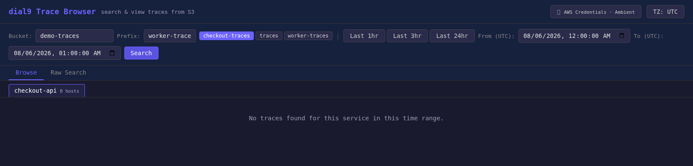
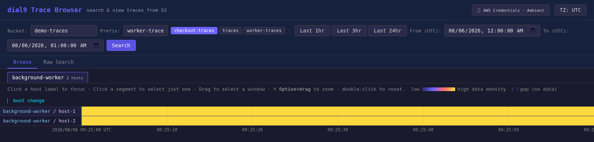

# Issue #1031: changing the trace prefix

Actual Chromium captures from the local Dial9 viewer, using the committed
public demo trace in its fake S3 backend.

- Before revision: `cec0420ba3e8781617066f7c0734ade243b2ec79`.
- Fixed revision: `31a332ab` (`codex/issue-1031-prefix-service`).
- Desktop viewport: 1600 × 900; typed prefix edit.
- Mobile viewport: 390 × 844; prefix suggestion click.

The demo trace was copied under two independent prefixes, each containing
two hosts: `checkout-traces` / `checkout-api` and `worker-traces` /
`background-worker`. Both use the trace window 2026-08-06 00:00–01:00 UTC.

1. Open the trace browser with `checkout-traces` and `checkout-api` selected.
2. Type `worker-traces` or click its prefix suggestion.
3. Press Search.

Before, `/api/browse` combines the new prefix with `service=checkout-api` and
the page reports no traces. After, `/api/services` discovers
`background-worker`, `/api/browse` uses that service, and both hosts appear.

| Before | After |
| --- | --- |
|  |  |

Recordings: [desktop before](before-desktop.webm) /
[desktop after](after-desktop.webm), [mobile before](before-mobile.webm) /
[mobile after](after-mobile.webm).

Mobile screenshots: [before](before-mobile.png) / [after](after-mobile.png).
